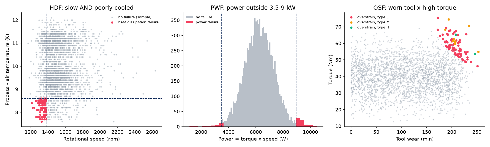
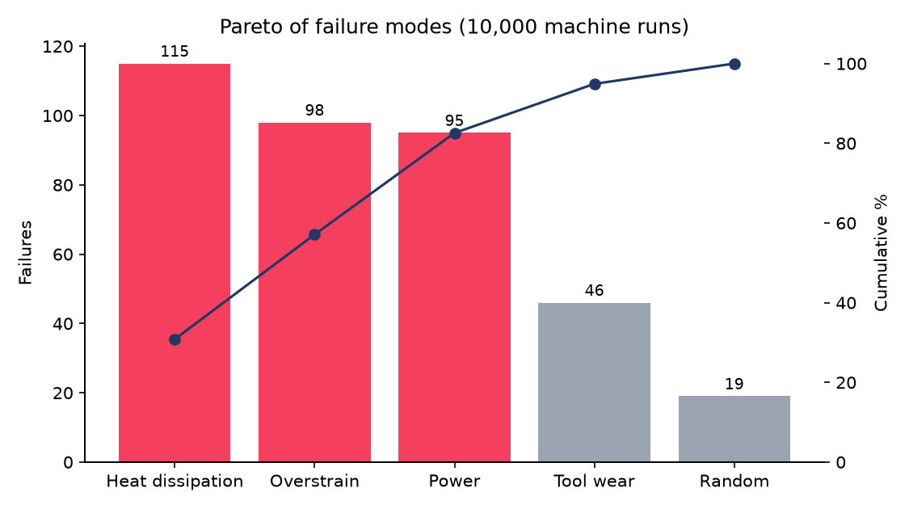
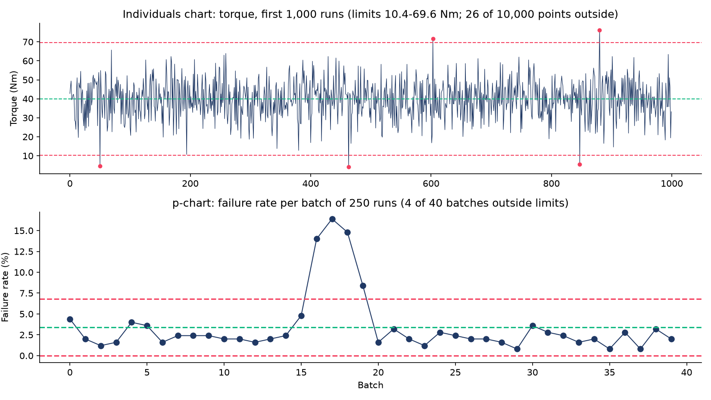
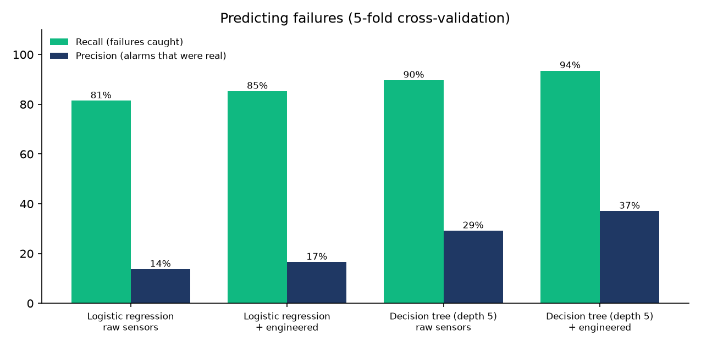

# Quality + Reliability Study: Why Machines Fail

A quality-engineering study of **10,000 machine runs** with 339 failures (AI4I 2020 predictive maintenance dataset). It uses Pareto analysis, root-cause analysis with physical features, SPC control charts, FMEA, a failure-prediction model and a tool-replacement policy.



## Key findings

| | |
|---|---|
| **Pareto** | 3 of 5 failure modes (heat dissipation, overstrain, power) cause **83%** of failures |
| **Root causes** | Each mode follows a clear physical threshold: **every** heat failure has a process-air temperature gap < 8.6 K **and** speed < 1,380 rpm; power failures happen below 3.5 kW or above 9 kW; overstrain starts at tool wear × torque ≈ 11,000 (L), 12,300 (M), 13,200 (H) min·Nm |
| **SPC special cause** | The p-chart flags 4 of 40 batches (runs 4,001-5,000) at ~15% failure rate vs 3.4% average. Cause: **air temperature 3 K higher**, cooling margin down from 10.2 to 8.4 K, and **94% of all heat failures** happened in that period |
| **Product quality** | Failure rate: L 3.9% · M 2.8% · H 2.1% |
| **Prediction** | Decision tree with engineered features catches **94%** of failures (317 of 339) with **69% fewer false alarms** than logistic regression on raw sensors (538 vs 1,742) |
| **Tool policy** | Replacing tools at **200 min** would take out the worn-tool condition behind **79%** of wear-driven failures; only 8% of runs go past 200 min |

> The AI4I 2020 dataset is **synthetic**: UCI describes it as reflecting real predictive-maintenance data from industry. The methods carry over to real plant data. The specific thresholds are properties of this dataset.

## 1 · Pareto: focus on the few modes that matter



| Mode | Failures | Cumulative |
|---|---|---|
| Heat dissipation (HDF) | 115 | 31% |
| Overstrain (OSF) | 98 | 57% |
| Power (PWF) | 95 | 83% |
| Tool wear (TWF) | 46 | 95% |
| Random (RNF) | 19 | 100% |

## 2 · Root causes from physics, not guesswork

Raw sensor readings hide the causes. Three engineered features expose them:

- **Temperature gap** = process temperature - air temperature (cooling margin)
- **Power** = torque × angular speed
- **Strain** = tool wear × torque

Shallow decision trees on these features recover each mode's threshold directly from the data (`outputs/tables/root_cause_trees.csv`). Tool-wear failures cluster between 198 and 253 min (median 214). Random failures (0.1% per run) show no sensor pattern and can't be prevented by monitoring.

## 3 · SPC: control charts found a hidden problem



- **Torque (individuals chart, moving-range sigma):** 26 of 10,000 points fall outside the 3-sigma limits (0.26%, about what you'd expect from chance), so torque is in control.
- **Failure rate (p-chart, batches of 250 runs):** batches 16-19 are far above the upper limit, a **special cause**.

| Runs 4,001-5,000 vs the rest | Flagged period | Rest |
|---|---|---|
| Air temperature | 302.7 K | 299.7 K |
| Temperature gap (cooling margin) | 8.4 K | 10.2 K |
| Heat failures | 108 | 7 |

The countermeasure points at cooling and ambient temperature control during hot periods, not at the machine settings.

## 4 · FMEA

Severity (S) and detection (D) are engineering judgment on a 1-10 scale (stated assumptions); occurrence (O) is scaled from the observed failure counts.

| Failure mode | Effect | Current control | S | O | D | RPN |
|---|---|---|---|---|---|---|
| Heat dissipation | Overheating stops the machine | Temperature gap + speed sensors | 7 | 8 | 3 | 168 |
| Overstrain | Tool breaks under load | Wear × torque by product type | 8 | 7 | 3 | 168 |
| Power | Motor stalls or overloads | Power monitoring | 7 | 7 | 3 | 147 |
| Tool wear | Worn tool fails | Wear counter (failure time varies) | 6 | 4 | 5 | 120 |
| Random | Unexplained | None possible | 6 | 2 | 10 | 120 |

## 5 · Predicting failures



Stratified 5-fold cross-validation, class-balanced models (failures are only 3.4% of runs):

| Model | Recall | Precision | Caught | Missed | False alarms |
|---|---|---|---|---|---|
| Logistic regression, raw sensors | 81% | 14% | 276 | 63 | 1,742 |
| Logistic regression, + engineered | 85% | 17% | 289 | 50 | 1,457 |
| Decision tree (depth 5), raw sensors | 90% | 29% | 304 | 35 | 738 |
| **Decision tree (depth 5), + engineered** | **94%** | **37%** | **317** | **22** | **538** |

Domain knowledge (the three physical features) beats a more complex model. A false alarm costs an inspection; a missed failure costs scrap and downtime, so recall is prioritised.

## 6 · Tool replacement policy

| Replace tool at | Wear-driven failures (TWF + OSF) at or past that wear | Runs past that wear |
|---|---|---|
| 175 min | 139 of 141 (99%) | 20% |
| **200 min** | **112 of 141 (79%)** | **8%** |
| 225 min | 26 of 141 (18%) | 1% |

An upper-bound estimate: failures at or past the limit would not have occurred on a worn tool, at the cost of more frequent tool changes.

## Run it

```bash
python3 -m venv .venv && source .venv/bin/activate
pip install -r requirements.txt
./run_all.sh
```

`run_all.sh` downloads the dataset from UCI if missing, runs the analysis and 9 tests.

## Limitations

- Synthetic dataset; thresholds are dataset-specific.
- FMEA severity and detection scores are judgment.
- Tool-policy savings are an upper bound (no cost model for tool changes).
- Runs are treated as time-ordered by their ID for SPC.

## Data

Stephan Matzka, *AI4I 2020 Predictive Maintenance Dataset*, UCI Machine Learning Repository, 2020. https://doi.org/10.24432/C5HS5C (CC BY 4.0)

## Tech

Python · pandas · scikit-learn · matplotlib · pytest

Author: Abderrahmane Messaoudi, Industrial Engineering & Engineering Management, University of Sharjah · [LinkedIn](https://www.linkedin.com/in/abderrahmane-messaoudi-984161273/)
